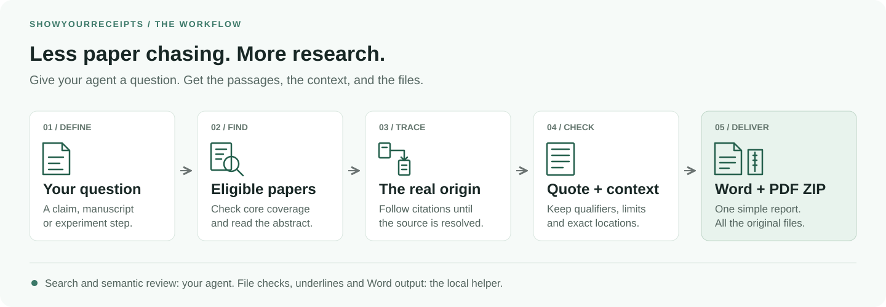
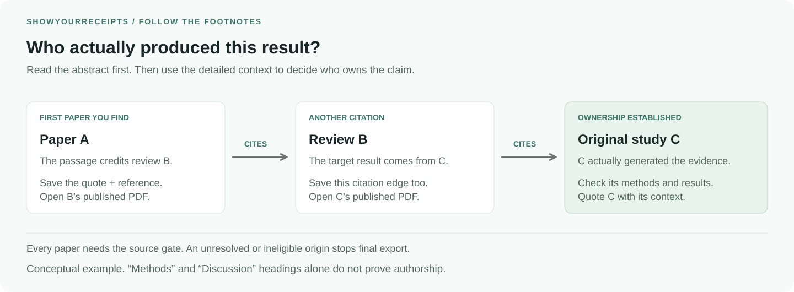
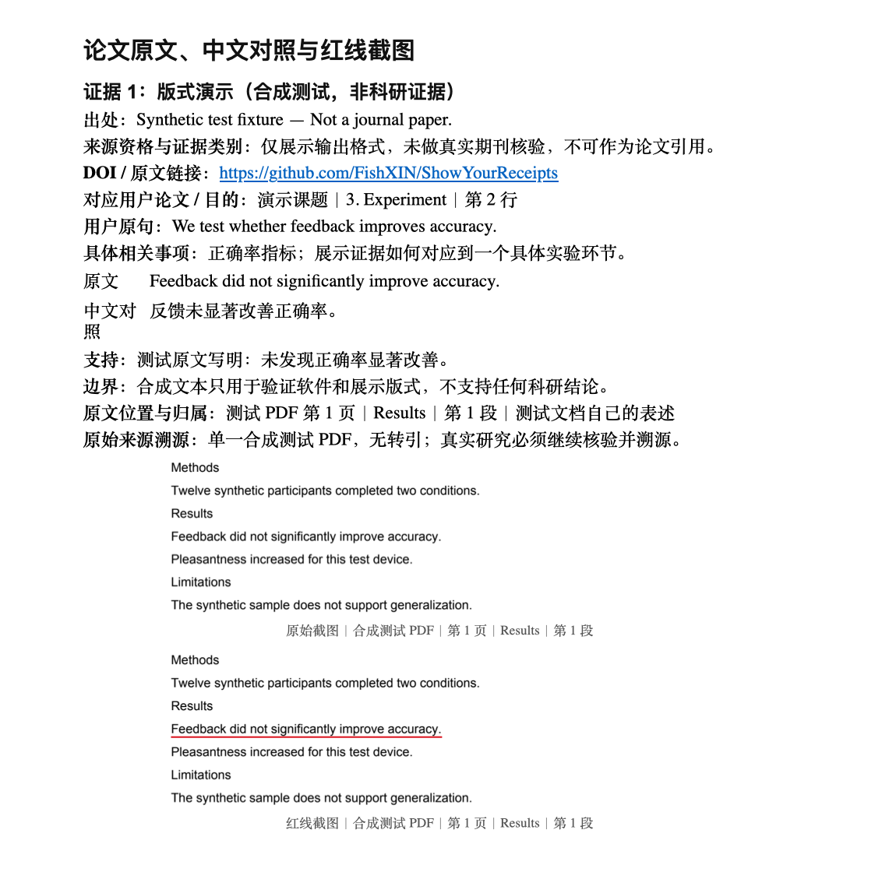
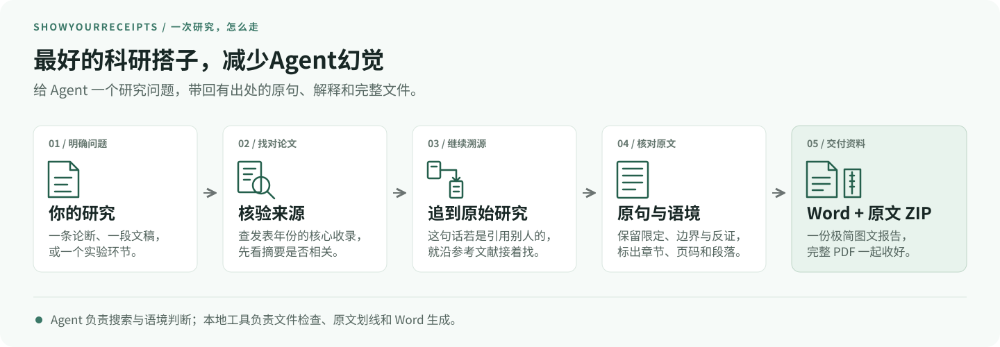
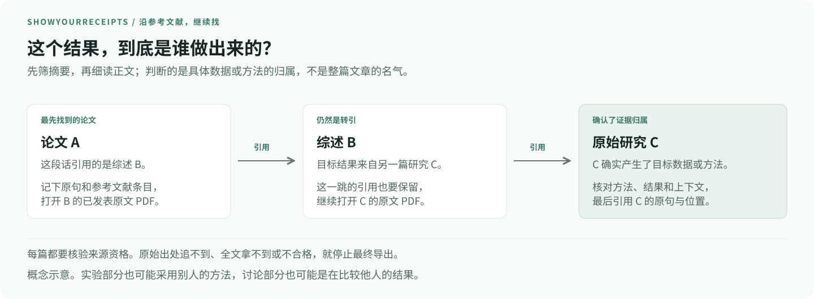

# ShowYourReceipts

**Less paper chasing. More research.**

[](https://github.com/FishXIN/ShowYourReceipts/actions/workflows/ci.yml)
[](LICENSE)
[](skills/show-your-receipts/SKILL.md)

For those “I know I read that somewhere” moments.

ShowYourReceipts gives your AI a repeatable way to find research evidence:
check the journal, follow the citation to its real origin, and show the exact
passage that relates to your work. You get **one simple Word report and a ZIP of
the original PDFs**, with quotes, translations, screenshots and limits together.

It's **one installable Agent Skill** for literature reviews, citation checks,
measurement scales and experimental justification. Use it with your agent's
search and reading tools, and spend less time retracing the same references.

**English first · [中文说明](#中文说明)**



*Your agent searches and reads. The local helper checks the files, draws the
underlines and builds the Word report.*

## Start with the part of your research you need help with

| You're working on… | Give the agent… | It helps you check… |
| --- | --- | --- |
| A literature review | A question or manuscript passage | Relevant original studies and the limits of their findings |
| A citation | The claim and its current reference | Who actually produced the evidence and where it appears |
| A measurement scale | The construct, population and setting | Original development/validation and whether it fits your use |
| An experiment | The design, variables and outcomes | Which exact steps have precedent and what still needs testing |

The report connects evidence to your **specific passage, hypothesis, scale or
experiment step**. It explains what the paper supports and what it cannot establish.

## Follow the footnotes all the way back

Finding a sentence in a paper is only the start. If that sentence cites someone
else, the agent opens that source and repeats the check. Every step keeps its
passage, reference entry, exact location and original PDF.



*A → B → C is a conceptual example. In a real task, every source must pass the
same core-journal checks. A review's own synthesis can support a synthesis claim;
it cannot stand in for an experiment it only cites.*

## See what you get

The final report is deliberately simple: **evidence by evidence, text and images**.
It has the source link, your research passage, the original quote and translation,
support and limits, source location, provenance, and original/underlined screenshots.

<p align="center">
  <a href="docs/images/word-layout-demo.png"></a>
</p>

*Actual output from the bundled Word renderer. This example uses explicitly
labeled synthetic test text; it is a **layout demo, not scientific evidence**.*
Click the preview to read it at full size.

Read the report to see:

- **Where it came from:** a clickable source link and section/page/paragraph.
- **Why it matters to you:** your exact research passage and the related step.
- **What the paper actually said:** the original text, translation and red underline.
- **Where the claim stops:** applicability limits and contrary or non-significant findings.

You receive one `.docx` and a matching `.zip`. The ZIP keeps the complete
original PDFs, citation-hop materials, images and review records.
No cover, table of contents or decorative analysis pages.

## Get your research sidekick

```bash
npx skills add FishXIN/ShowYourReceipts --skill show-your-receipts
```

Then give your agent a task:

> Use ShowYourReceipts to find core-journal evidence for my experiment.
> Trace the claims to their original papers, show the key passages, explain
> which parts of my experiment they support, and deliver the fixed Word report
> with the PDFs in its matching ZIP.
> Tell me where the evidence runs out.

For a pinned version, download the [release](https://github.com/FishXIN/ShowYourReceipts/releases)
or copy the skill from a tagged checkout:

```bash
git clone --branch v0.1.2 --depth 1 https://github.com/FishXIN/ShowYourReceipts.git
mkdir -p /path/to/project/.agents/skills
cp -R ShowYourReceipts/skills/show-your-receipts /path/to/project/.agents/skills/
```

Use the skill directory your agent supports:

| Agent | Project skill directory |
| --- | --- |
| Codex / Agent Skills clients | `.agents/skills/` |
| Claude Code | `.claude/skills/` |
| GitHub Copilot | `.github/skills/` |
| TRAE | `.trae/skills/` |

If your agent doesn't load skills automatically, ask it to read
[SKILL.md](skills/show-your-receipts/SKILL.md) and its linked guides first.

## Fast research still needs a trail

Three rules keep the shortcuts honest:

1. **Check the journal.** Accept SCIE, SSCI, AHCI, CSSCI, CSCD core or PKU core
   journal articles, with official coverage verified for the publication year.
2. **Check who said it.** A sentence in “Methods” or “Discussion” can still cite
   someone else's work. Follow the references until the real origin is clear.
3. **Show the source.** Keep complete PDFs, literal passages and their context.
   Missing full text or unresolved provenance blocks final export.

This helps reduce unsupported AI claims. Study quality, source authenticity and
interpretation still need a researcher’s judgment.

The agent makes the semantic assessments; the helper checks the submitted
records, literal PDF matches and file consistency. If the original source cannot
be resolved or its full text is unavailable, the agent reports the gap.

## Local tools

The skill includes a Python helper for downloading public PDFs, marking passages,
checking records and packaging evidence. Requires Python **3.10–3.13**,
Node.js **20+** and text PDFs.

```bash
python3 -m venv /path/to/task/.venv
/path/to/task/.venv/bin/python -m pip install \
  -r /path/to/skill/scripts/requirements.txt
npm ci --ignore-scripts --no-audit --no-fund --prefix /path/to/skill/scripts
```

Your agent follows the [skill instructions](skills/show-your-receipts/SKILL.md).
For manual use, the [packet guide](skills/show-your-receipts/references/packet-format.md)
covers the commands and input templates.
The [Word layout](skills/show-your-receipts/references/word-output.md) is fixed.
After checking the evidence packets, combine them with:

```bash
python "$SKILL_DIR/scripts/receipts.py" deliver \
  --bundles receipt-001 receipt-002 --out "/path/to/task/论文证据.docx"
```

Search and access depend on your agent and its available tools. The helper
downloads lawful public PDFs; it does not log in or bypass paywalls.
Evidence packs stay local unless you choose to share them.
Scanned, encrypted, rotated or unsupported PDF layouts are rejected.

## Contribute

Have a citation that keeps sending an agent in circles? Found a misleading
quote or a broken check? [Open an issue](https://github.com/FishXIN/ShowYourReceipts/issues)
or see [CONTRIBUTING.md](CONTRIBUTING.md).

The repository contains one self-contained skill, tests, project configuration
and [documentation visuals](docs/README.md). It ships no research papers, private
manuscripts or credentials. Project code and original diagrams are MIT.

CI runs 47 adversarial tests across Linux, macOS and Windows on Python 3.10–3.13.

```bash
python .github/scripts/validate_skill.py
python -m unittest discover -s tests -v
```

---

## 中文说明

**最好的科研搭子，减少Agent幻觉**

「我记得有篇论文这么说过。」让你的科研搭子接着找。

ShowYourReceipts 给你的 AI 一套查证办法：找核心期刊论文，追到真正的
原始出处，把与你的研究有关的原句画出来。最后交给你**一份极简图文 Word
和完整原文 ZIP**，出处、翻译、截图与边界放在一起，下次不用从头翻。

一个 Skill，配合常用 Agent 的搜索和阅读工具，就能帮你写综述、查引用、
选量表、找实验依据，把重复查证和整理的功夫省下来。



*Agent 负责搜索和阅读，本地工具负责文件检查、原文划线和 Word 生成。*

### 从你的研究问题开始

| 你在做什么 | 交给 Agent 什么 | 帮你核对什么 |
| --- | --- | --- |
| 写文献综述 | 一个问题或一段文稿 | 相关原始研究，以及发现的适用边界 |
| 检查引用 | 一条论断和当前引用 | 证据真正来自谁、具体在哪一段 |
| 选择量表 | 测量目标、人群和场景 | 原始开发与验证，以及是否适合你的用法 |
| 设计实验 | 方案、变量和测量指标 | 哪个步骤有依据、哪些地方仍需预实验 |

它会说明论文对应你文稿的哪个位置，支持哪个假设、量表或实验环节。
找到“相关论文”以后，还要继续看它究竟能支持什么、不能证明什么。

### 沿引用追到真正的原始出处

要先判断这是谁的发现。若论文 A 引用了综述 B，而 B 又引用了研究 C，
就继续追到 C，检查它是否确实产生了目标数据或方法。
每一跳都保留引用原句、参考文献条目、具体位置和完整 PDF。



*这是概念示意，每篇真实来源都需要核验。综述自己算出的综合结果可以支持
综合结论，不能被写成它亲自完成了引用的实验。*

### 最后拿到什么

**一份逐条证据的极简 Word，加一个原文压缩包。**
Word 里写出处和完整链接、对应你的研究、原句与中文对照、支持与边界、
原文位置和溯源，再放原图与红线图。

<p align="center">
  <a href="docs/images/word-layout-demo.png"></a>
</p>

*这是实际生成器输出的版式示例。图中内容来自合成测试，
**只展示排版，不是科研证据，不可用于论文引用。***
点击截图可以放大查看。

- **查出处：** 点开原文链接，按章节、页码和段落回到源文。
- **看关系：** 直接看到它对应你研究的哪一句、哪一个环节。
- **核原句：** 原文、翻译和划线截图一起看，保留限定和不显著结果。
- **留资料：** ZIP 保存完整 PDF、逐跳引用材料、原图和复核记录。

最终固定用这套图文结构，不加封面、目录、装饰或额外分析页。

### 开始用

```bash
npx skills add FishXIN/ShowYourReceipts --skill show-your-receipts
```

装好后，直接对 Agent 说：

> 帮我找这个实验的核心期刊依据。追到真正的原始论文，把关键原句画出来，
> 说明它支持我实验的哪个环节，按固定版式输出图文 Word，
> 再把 PDF 和资料打包。找不到依据就直说。

也可以从 [发布页](https://github.com/FishXIN/ShowYourReceipts/releases)
下载，按上方目录表放进你的 Agent。
本地工具需要 Python 3.10–3.13、Node.js 20+；具体步骤交给 Skill 指引。

固定版式由本地工具生成，Agent 按 Skill 整理证据。
手动使用时，见 [Word 输出说明](skills/show-your-receipts/references/word-output.md)。

### 找得快，出处也要跟得上

只接受核验过发表年份收录范围的指定核心期刊。
实验部分可能采用他人方法，讨论部分也可能比较他人成果；
要看语境，追到真正产生目标数据或方法的论文。
原文拿不到、出处没追清，就说明缺口，不把转引当成最终依据。

它帮你减少无依据的回答、节省查证和整理的功夫。
Agent 负责语境判断，脚本核对原句、文件和记录的一致性；
论文质量与结论解读，仍需要你的专业判断。资料默认留在本地。
